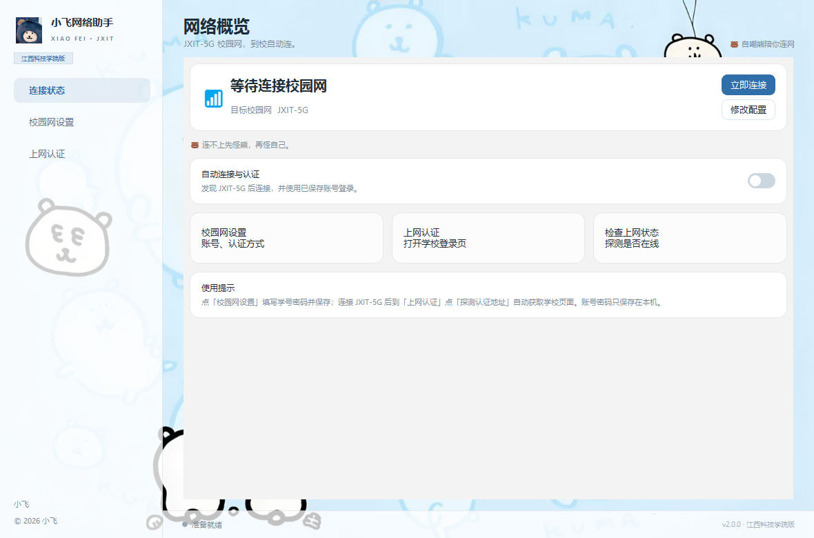
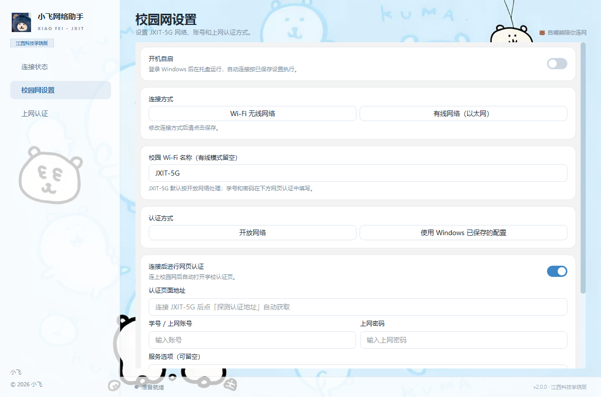

# 小飞网络助手（江西科技学院版）

自己在宿舍懒得每次开机都手动连 `JXIT-5G`、再打开网页输一遍学号密码，就写了这个小工具。它是个 Windows 桌面程序：连上校园 Wi‑Fi 后自动把学校那个锐捷认证页打开、帮你填好账号密码点登录，断网了还会自己重连。界面用 Python + PySide6 写的，随手套了个自嘲熊的壁纸当背景。

 

## 能干嘛

- 开机自动在后台跑，托盘里待着，不用一直盯着窗口
- 连 `JXIT-5G`（只认这个全名，别名的不连），连上后自动开认证页
- 账号密码自动填、能勾的协议自动勾、点登录，然后看学校返回的结果判断有没有成
- 掉线了过一会儿自己再认证一次（一开始 1 分钟一次，越拖越久，最多 5 分钟）
- 学号密码只存在你自己电脑上，用 Windows 的 DPAPI 加密，不往任何地方传
- 顺带支持插网线的情况：PPPoE 拨号 / 802.1X / 学校那种要单独开客户端的

## 长这样

| 连接状态 | 校园网设置 | 上网认证 |
| :---: | :---: | :---: |
|  |  |  |

## 怎么用

装个 Python 3.10 以上（Win10/11 都行），然后：

```powershell
pip install -r requirements.txt
python run.py
```

第一次打开，去「校园网设置」把学号和上网密码填了，认证地址那栏**可以先空着**——连上 JXIT 之后它会自己去探测。保存之后想让它开机自己连，就把「自动连接」和「开机自启」都打开。

嫌命令行麻烦的话，双击 `run.bat` 也能跑。

## 打包成 exe

想发给同学、不想让他们装 Python 的话：

```powershell
pyinstaller --noconfirm --clean --windowed --name 小飞网络助手 `
  --icon xiaofei/resources/app.ico `
  --add-data "xiaofei/resources;xiaofei/resources" run.py
```

打完在 `dist/小飞网络助手/` 里，整个文件夹拷走双击 `小飞网络助手.exe` 就行（带 QtWebEngine，所以文件夹挺大的）。

## 代码大概分这几块

- `xiaofei/model.py`：配置、自动重连的策略和退避
- `xiaofei/portal_script.py` + `portal.py`：往学校认证页里注入脚本、自动填写提交那套
- `xiaofei/wifi.py`：调 netsh 扫描和连接
- `xiaofei/store.py` / `startup.py`：本地加密存配置、开机自启写注册表
- `xiaofei/ui.py` / `theme.py`：界面
- `tests/`：一些不用联网、不开界面的自检（`python tests/run_checks.py`）

## 碎碎念 / 已知问题

- 认证页要用 WebView2，Win11 一般自带，太老的 Win10 没有的话装个 Microsoft Edge WebView2 Runtime。
- 扫不到 Wi‑Fi、提示要定位权限的，去「设置 → 隐私 → 位置」把桌面应用的位置打开。
- 换电脑后密码解不开是正常的，DPAPI 绑的是当前 Windows 用户，重新输一次。
- 学校要是改了认证页，脚本可能认不出输入框，那就去「高级设置」里手动填 CSS 选择器，或者直接在网页里自己点。
- 我这边没法真机跑打包好的 exe 验证（环境限制），代码逻辑和界面是测过的，同学用了有问题可以找我。

有问题直接找我（小飞）。别在截图 / issue 里带自己的账号密码。

## 许可

MIT，随便用，见 [LICENSE](LICENSE)。Python、Qt、WebView2 这些第三方还是各自的协议。
